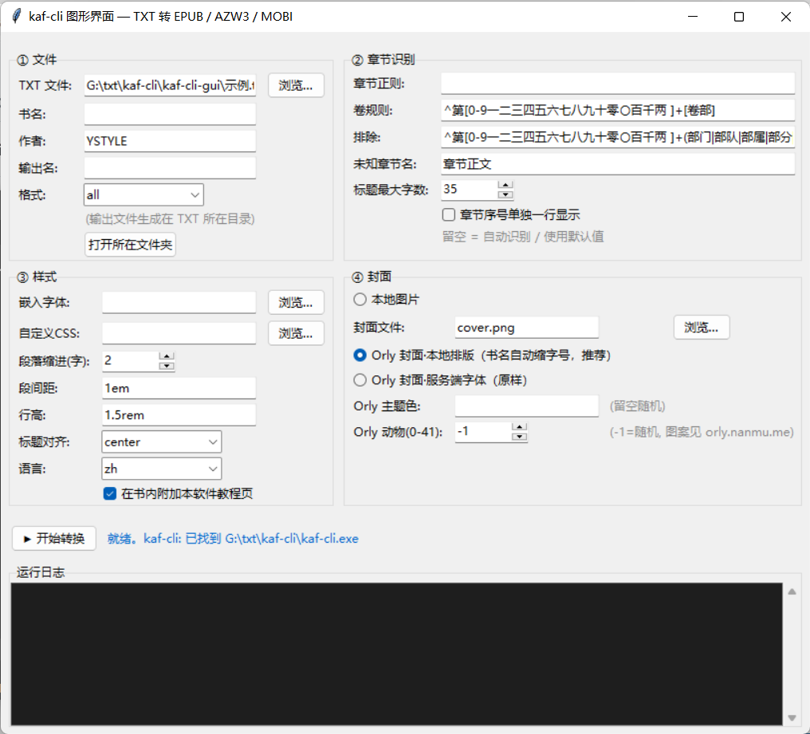

# kaf-cli-gui

[kaf-cli](https://github.com/ystyle/kaf-cli)（TXT → EPUB/AZW3/MOBI 命令行工具）的桌面图形界面。Python + Tkinter，全程鼠标操作，仿 EasyPub 风格。



## 功能
- **① 文件**：选 TXT、书名/作者、输出名、格式（all/epub/azw3/mobi）、打开输出目录
- **② 章节识别**：章节正则 / 卷规则 / 排除规则 / 未知章节名，全部预填 kaf-cli 默认值，留空即走内置默认
- **③ 样式**：嵌入中文字体（ttf/otf，Nook + KoReader 强烈推荐）、自定义 CSS、缩进、行距、标题对齐、tips 开关
- **④ 封面**：三种模式
  - 本地图片
  - **Orly 封面·本地排版（默认）**：从 orly.nanmu.me 取无字底图，本地自动排书名/作者，**字号自适应，长书名不截断**（自动缩字号，超宽自动断两行）
  - Orly 封面·服务端字体（kaf-cli 原生 orly 模式，长书名会被服务端截断）
- 实时日志窗口，显示 kaf-cli 完整输出

## 依赖
- Windows，Python 3.10+（tkinter 为标准库自带）
- [kaf-cli.exe](https://github.com/ystyle/kaf-cli/releases)（v1.3.16+），放在程序目录内或上一级目录

## 打包
```powershell
# 一键（自动装依赖、下 kaf-cli.exe、onedir 打包、摆好目录）
powershell -ExecutionPolicy Bypass -File .\build.ps1
```
或手动：
```
pip install pyinstaller pillow
python -m PyInstaller --clean -y --onedir --windowed --name kaf-cli-gui kaf_gui.py
```
> 只推荐 onedir。onefile 在部分受限环境（沙箱/受管终端）下会因无法向临时目录写解包文件而弹 Tk Error 窗。
> 打包后的 kaf-cli-gui 文件夹（exe + _internal）整体使用，不要把 exe 单拷出来。

## 使用说明
见 [USAGE.md](USAGE.md)。

## 致谢
- [ystyle/kaf-cli](https://github.com/ystyle/kaf-cli)：核心转换引擎
- [orly.nanmu.me](https://orly.nanmu.me)：封面底图服务

## License
本仓库 GUI 代码采用 [MIT](LICENSE) 协议；kaf-cli 本体以其仓库协议为准。
